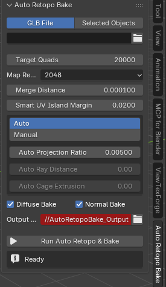
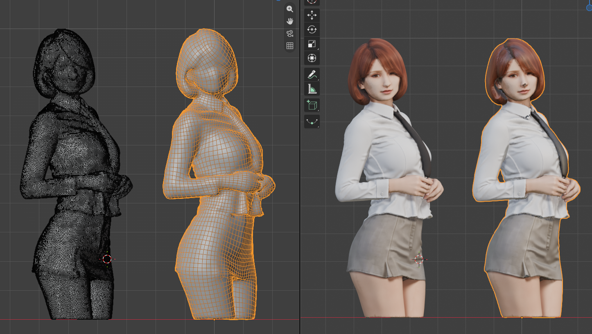
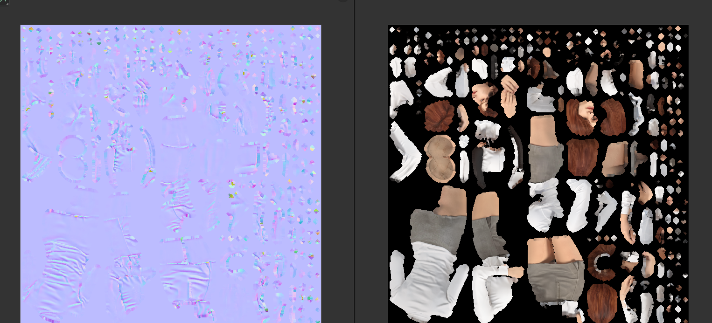

# Auto Retopo Bake

A Blender add-on for automatic retopology, Smart UV generation, and Diffuse / Normal Map baking using [AutoRemesher](https://github.com/huxingyi/autoremesher).

Auto Retopo Bake was originally developed to automate the post-processing workflow for GLB models generated by **Hunyuan3D 2.1**, but it can also be used with other mesh assets.

> This is an independent project and is not affiliated with or endorsed by Tencent or the AutoRemesher project.

---

## Overview

Auto Retopo Bake automates a workflow that would normally require several manual steps in Blender:

```text
High Poly Mesh
      ↓
Merge by Distance
      ↓
AutoRemesher
      ↓
Low Poly Quad Mesh
      ↓
Smart UV Project
      ↓
Diffuse / Base Color Bake
      ↓
Tangent Space Normal Bake
      ↓
Ready-to-use Low Poly Mesh
```

The add-on supports both:

- importing and processing a GLB file
- processing multiple mesh objects already selected in Blender

Non-mesh objects such as Cameras, Lights, Empties, and Armatures are ignored in Selected Objects mode.

---

## Features

- GLB file processing directly from the Blender sidebar
- Batch processing of selected Mesh objects
- Automatic quad retopology using AutoRemesher
- Merge by Distance before retopology
- Smart UV Project generation
- Diffuse / Base Color baking
- Tangent Space Normal Map baking
- Automatic or manual Ray Distance / Cage Extrusion
- Configurable target quad count
- Persistent Output Directory setting saved in Add-on Preferences
- Configurable texture resolution from 512 to 8192
- Automatic Low Poly material setup
- Diffuse texture connected to Principled BSDF Base Color
- Normal texture connected through a Normal Map node
- Batch progress display
- Total elapsed time display
- Object-by-object error handling in Batch mode
- Original selected objects are preserved
- Windows and Linux support

---

## Screenshots

### Add-on Panel



### High Poly → Low Poly



### Baked Result




---

## Requirements

### Blender

Tested with:

```text
Blender 5.2.0 LTS
```

The add-on is currently developed and validated against Blender 5.2.

### AutoRemesher

Auto Retopo Bake requires:

```text
AutoRemesher 1.1.0
```

AutoRemesher is a separate open-source project and is **not bundled with this add-on**.

Download or build AutoRemesher from:

[https://github.com/huxingyi/autoremesher](https://github.com/huxingyi/autoremesher)

After installing the add-on, set the AutoRemesher executable path in the add-on preferences.

---

## Tested Platforms

The add-on has been tested on:

```text
Linux
Windows
```

Linux testing was performed with Blender 5.2.0 LTS and AutoRemesher 1.1.0.

Windows operation has also been verified.

---

## Installation

1. Download `AutoRetopoBake.zip` from the latest GitHub Release.

2. Open Blender.

3. Go to:

```text
Edit
→ Preferences
→ Add-ons
→ Install from Disk
```

4. Select:

```text
AutoRetopoBake.zip
```

5. Enable:

```text
Auto Retopo Bake
```

6. Open the add-on preferences and specify the AutoRemesher executable.

Example on Linux:

```text
/path/to/AutoRemesher.AppImage
```

Example on Windows:

```text
C:\path\to\autoremesher.exe
```

---

## Opening the Add-on

In the Blender 3D Viewport:

```text
N
→ Auto Retopo Bake
```

The add-on appears in the Sidebar.

---

# Usage

Auto Retopo Bake provides two input modes.

---

## Mode 1 — GLB File

Use this mode when you want to process a GLB file directly.

1. Select:

```text
Input Mode
→ GLB File
```

2. Click the folder icon.

3. Select a `.glb` file.

4. Configure the retopology and bake settings.

5. Click:

```text
Run Auto Retopo & Bake
```

The add-on will:

```text
Import GLB
→ Prepare High Poly
→ Merge by Distance
→ Export temporary OBJ
→ Run AutoRemesher
→ Import Low Poly
→ Smart UV
→ Bake Diffuse
→ Bake Normal
→ Configure Low Poly Material
```

---

## Mode 2 — Selected Objects

Use this mode for objects that are already in the Blender scene.

1. Select one or more objects in the 3D Viewport.

2. Select:

```text
Input Mode
→ Selected Objects
```

3. Click:

```text
Run Auto Retopo & Bake
```

Only objects with:

```python
type == 'MESH'
```

are processed.

Other selected object types are ignored.

Each Mesh object is processed independently.

For example:

```text
Body
Hair
Shoes
Camera
Light
```

produces:

```text
Body
Hair
Shoes

Body_LP
Hair_LP
Shoes_LP
```

The Camera and Light are ignored.

The original selected Mesh objects are used directly as the High Poly bake sources and are not replaced or modified.

A temporary copy is internally created for Merge by Distance and AutoRemesher input, then removed after processing.

---

# Settings

## Target Quads

Controls the target quad count requested from AutoRemesher.

Default:

```text
30000
```

The actual result may differ depending on the geometry.

---

## Output Directory

Controls where generated texture maps and exported Low Poly OBJ files are saved.

The Output Directory is stored in the add-on preferences. Once set, it is preserved after closing Blender and is also available when opening another `.blend` file.

Changing the Output Directory automatically updates the saved preference, so no manual Preferences save is required.

---

## Map Resolution

Default:

```text
2048
```

Available resolutions include:

```text
512
1024
2048
4096
8192
```

The selected resolution is used for the baked texture maps.

Higher resolutions require more memory and longer bake times.

---

## Merge Distance

Controls the distance used by Merge by Distance before sending geometry to AutoRemesher.

Use a small value unless the source mesh specifically requires more aggressive vertex merging.

---

## Projection Mode

Two modes are available:

```text
Auto
Manual
```

### Auto

Auto Retopo Bake calculates projection values automatically based on the size of the model.

This is the recommended default.

### Manual

Allows direct control over:

```text
Ray Distance
Cage Extrusion
```

Manual mode can be useful when the High Poly and Low Poly surfaces differ significantly or when automatic projection produces bake artifacts.

---

## Diffuse Bake

When enabled, the add-on transfers the High Poly Base Color / Diffuse information to the Low Poly UV layout.

Only the color contribution is baked.

Direct and indirect lighting are not included.

The resulting Diffuse image uses:

```text
sRGB
```

---

## Normal Bake

When enabled, Auto Retopo Bake creates a Tangent Space Normal Map from the High Poly geometry.

The resulting Normal Map uses:

```text
Non-Color
```

The final Low Poly material is configured approximately as:

```text
Diffuse Image
    ↓
Principled BSDF Base Color

Normal Image
    ↓
Normal Map
    ↓
Principled BSDF Normal
```

---

# Progress Display

During processing, the add-on displays the current stage.

Example:

```text
Progress: 7/9 Bake Diffuse
Elapsed: 01:43
```

In Selected Objects Batch mode, the current object is also displayed:

```text
Object: 2/4 Hair
Progress: 7/9 Bake Diffuse
Elapsed: 01:43
```

Elapsed time represents the total runtime since the operation started.

After completion, the final time remains visible.

Example:

```text
Completed: 4/4 objects
Elapsed: 05:42
```

If one or more objects fail:

```text
Completed: 3 succeeded / 1 failed
```

Processing continues with the remaining objects whenever it is safe to do so.

---

# Output

Depending on the selected options, Auto Retopo Bake generates:

```text
<name>_diffuse.png
<name>_normal.png
<name>_low.obj
```

The Low Poly object is also kept in the Blender scene.

For Selected Objects mode, Low Poly objects use the `_LP` suffix.

Example:

```text
Body
Body_LP
```

The original selected object remains unchanged and is used as the High Poly bake source.

---

# Hunyuan3D 2.1 Workflow

Auto Retopo Bake was originally created to automate the post-processing of meshes generated with Hunyuan3D 2.1.

A typical workflow is:

```text
Hunyuan3D 2.1
      ↓
Generated GLB
      ↓
Auto Retopo Bake
      ↓
Quad Retopology
      ↓
Smart UV
      ↓
Diffuse Bake
      ↓
Normal Bake
      ↓
Game / Rendering / Editing Workflow
```

However, Hunyuan3D is **not required**.

Any suitable Blender Mesh or GLB asset can be used.

Auto Retopo Bake does not include Hunyuan3D code, model weights, or other Hunyuan3D components.

---

# Linux Notes

AutoRemesher AppImage is supported.

The add-on contains handling for environments where normal AppImage FUSE mounting is unavailable.

Depending on the AutoRemesher build and Linux environment, Qt/X11 requirements may still apply.

Make sure the AutoRemesher executable has execution permission:

```bash
chmod +x /path/to/AutoRemesher.AppImage
```

---

# Windows Notes

Set the AutoRemesher path to the Windows executable:

```text
C:\path\to\autoremesher.exe
```

No Linux-specific AppImage configuration is required.

---

# Known Limitations

### Blender UI may temporarily stop updating

Processing is currently synchronous.

AutoRemesher and Cycles baking may temporarily occupy Blender's main thread, so the interface can appear unresponsive during heavy operations.

The elapsed-time measurement continues internally and updates correctly when Blender becomes responsive again.

### Bake quality depends on geometry

Projection quality depends on the geometric difference between the High Poly and Low Poly meshes.

Areas such as:

- fingers
- hair
- thin surfaces
- overlapping surfaces
- deep cavities
- closely spaced geometry

may require manual Ray Distance or Cage Extrusion adjustment.

### AutoRemesher target count is approximate

The requested Target Quads value is a target, not a guaranteed exact polygon count.

### Temporary files

AutoRemesher requires temporary OBJ files during processing.

Temporary working files may be retained for debugging depending on the add-on configuration.

---

# Troubleshooting

## AutoRemesher does not start

Verify that the executable path is correct.

Linux:

```bash
chmod +x /path/to/AutoRemesher.AppImage
```

Windows:

Confirm that the selected path points to the AutoRemesher `.exe`.

---

## Bake contains missing or incorrect areas

Try switching:

```text
Projection Mode
Auto → Manual
```

and increase:

```text
Ray Distance
Cage Extrusion
```

gradually.

---

## Blender appears frozen

AutoRemesher and Cycles Bake can block Blender's main thread while processing.

Wait for the current operation to finish before assuming Blender has crashed.

Terminal output can also be useful for monitoring the current stage.

---

# Design Notes

The add-on intentionally avoids automating Blender through mouse or keyboard input.

It uses:

- Blender Python API
- `bmesh`
- Blender OBJ import/export
- AutoRemesher CLI
- Cycles Bake

Node lookup does not depend on localized Blender node names.

Shader nodes are identified using Blender node types, socket identifiers, and internal purpose tags so the add-on works with localized Blender interfaces such as Japanese.

---

# Version

Current public version:

```text
1.2.0
```

---

# License

See the `LICENSE` file included with this repository.

AutoRemesher is a separate project and is distributed under its own license.

Hunyuan3D is a separate project and is distributed under its own license.

---

# Credits

## AutoRemesher

Automatic quad remeshing is performed using:

[https://github.com/huxingyi/autoremesher](https://github.com/huxingyi/autoremesher)

## Blender

[https://www.blender.org/](https://www.blender.org/)

## Hunyuan3D 2.1

Auto Retopo Bake was originally developed around a Hunyuan3D 2.1 post-processing workflow.

Hunyuan3D itself is not included in this repository.

---

# Disclaimer

This software is provided as-is.

Always keep backups of important Blender projects before running automated geometry-processing or baking tools.

Auto Retopo Bake is an independent project and is not affiliated with or endorsed by Blender Foundation, Tencent, or the AutoRemesher project.

